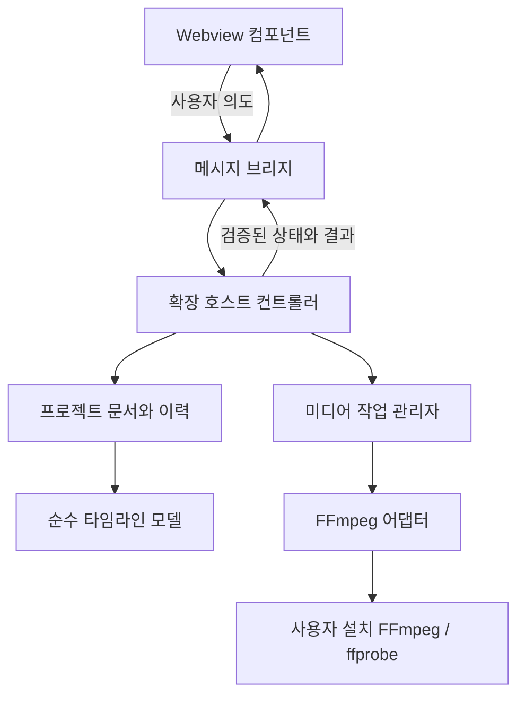

# 비디오 편집기 컴포넌트 가이드

상태: 구현 전 설계안. 이름과 경로는 책임을 설명하기 위한 제안이며 실제 코드나 채택한 프레임워크를 의미하지 않는다. 화면 배치는 [UI 가이드](ui-guide.md), 시간·편집 계약은 [상세 설계](detailed-design.md), 외부 도구는 [미디어 엔진 연동](media-engine-distribution.md)을 따른다.

## 1. 구성과 의존 방향



- 컴포넌트는 프로젝트를 직접 수정하지 않고 사용자 의도를 보낸다. 확장 호스트의 문서가 편집 데이터와 revision의 기준이다.
- 타임라인 모델은 VS Code, DOM, 프로세스에 의존하지 않는 순수 연산으로 둔다. 미디어 어댑터는 셸을 통하지 않고 외부 도구를 실행한다.
- Webview는 임의의 실행 파일·인자·환경 변수를 요청하지 않는다. 원본 영상 전체나 대용량 PCM을 메시지에 직렬화해 주고받지 않는다. 프레임 전달 방식은 아직 검증되지 않은 설계 결정이다.
- 아래 구조는 권장 경계이며 대규모 프레임워크나 특정 파일 분할을 강제하지 않는다.

## 2. 공통 UI 컴포넌트

| 컴포넌트 | 입력·상태 | 사용자 동작 / 출력 | 주요 제약 |
| --- | --- | --- | --- |
| EditorShell | 프로젝트 이름, 수정 상태, 모드, 작업 상태 | Save, Export, 모드 전환 | 저장과 출력의 의미를 구분하고 실패를 표시한다. |
| ModeSelector | Preview / Edit | 모드 변경 | 접근성 선택 상태와 키보드 지원. 전환은 재생을 일시정지하며 편집 이력을 바꾸지 않는다. |
| TargetSelector | Source의 선택된 자산 또는 Timeline | 미리보기 대상 변경 | 대상별 위치를 따로 유지한다. 미선택·빈 타임라인을 표시한다. |
| EngineStatus | 검사 상태, 누락 기능, 오류 | 설정 열기, 재검사, 설치 안내 | 엔진 미설치여도 빈 화면과 모드 전환은 가능하다. |
| TaskStatus | 작업 ID, 상태, 진행률, 취소 가능 여부 | 취소 요청 | 진행률 미확인이면 불확정 표시. 완료·취소·실패를 구분한다. |
| ErrorNotice | 오류 코드, 안전한 설명과 복구 동작 | 재시도·설정·닫기 등 | 사용자 경로 등 민감 정보를 불필요하게 표시하지 않는다. |

컨트롤의 활성 여부와 이유는 모델·엔진·작업 상태에 따라 결정한다. UI에서 숨기거나 비활성화하는 것만으로 권한 검사를 대신하지 않는다.

## 3. 미리보기와 재생

| 컴포넌트 | 책임 | 검증해야 할 상태 |
| --- | --- | --- |
| VideoViewport | 선택한 대상의 프레임과 빈 상태를 표시 | 탐색 중, 이전 응답 폐기, 디코딩 실패, 원본 없음 |
| TransportControls | Play/Pause, 시작·끝, 이전·다음 프레임 | 재생 상태별 이름, 미디어 없음, 끝에 도달, 장치 없음 |
| SeekControl | 위치·길이·프레임 정보를 표시하고 탐색 요청 | 키보드 이동, 시작·끝, 빠른 연속 입력, 대상별 위치 |
| FrameExport | 표시 위치의 프레임 저장 요청 | 작업 중, 취소, 원본 경로 거부, 저장 실패 |

원본 프레임 이동은 표시 PTS 순서이고 Timeline은 프로젝트 프레임 격자다. 탐색 결과는 요청 ID·대상·revision을 확인하고 오래된 결과를 버린다. 모드 전환의 일시정지·위치 보존과 오디오 시계 규칙은 상세 설계를 따른다. Preview 모드에서 편집 명령은 Host에서도 거부한다.

## 4. 편집 화면

| 컴포넌트 | 책임 | 검증해야 할 상태 |
| --- | --- | --- |
| MediaPanel | 미디어 목록·메타데이터, 가져오기·선택·재연결 | probe 성공 전 기존 상태 보존, 손상·누락 원본 |
| TimelineView / Ruler | 눈금, 재생 헤드, 스크롤·확대·스냅 | 시간과 위치 정렬, 시작·끝, 줌 후 위치 보존 |
| TrackLane | 영상 트랙 1개와 여러 오디오 트랙을 표시 | 트랙별 음소거·게인, 빈 구간, 충돌 |
| ClipView | 이름·경계·선택·A/V 연결 상태 표시 | 이동·트림·분할, 겹침 거부, 원본 범위 |
| TimelineToolbar | Split, Delete, Ripple Delete, Snap, Undo/Redo | 조건에 맞는 활성 상태와 실패 이유 |
| AudioControls / Waveform | 클립·트랙 게인·음소거·페이드, 파형 | 원본 A/V 분리, 생성 중·오류, 클리핑 경고 |

클립과 트랙 식별자는 배열 순서가 아니라 안정적인 ID를 사용한다. 드래그 중의 임시 표현은 프로젝트 이력을 만들지 않고, 확정 명령이 성공한 뒤 Host 스냅샷으로 동기화한다. 키보드로도 클립 선택·이동·트림 및 오디오 설정이 가능해야 한다. 구체적 단축키와 픽셀 기준 스냅 거리는 검증 후 확정한다.

## 5. 호스트와 미디어 컴포넌트

| 컴포넌트 | 책임 | 경계 및 실패 처리 |
| --- | --- | --- |
| EditorController | VS Code 명령과 Webview 수명주기, 메시지 검증 | 모드·revision·입력을 확인하고 예외를 응답한다. 종료 시 리스너·작업을 정리한다. |
| ProjectDocument | 스키마 검증, 저장·백업·복구 및 수정 상태 | 저장 실패 시 기존 파일·수정 상태 보존. 미지원 버전은 덮어쓰지 않는다. |
| TimelineModel / History | 유리수 시간, 클립·트랙 불변식, 명령과 undo/redo | 충돌·범위 오류는 변경과 이력 없이 거부한다. 원본 파일을 수정하지 않는다. |
| EngineDiscovery | 설정 또는 PATH에서 ffmpeg·ffprobe를 찾고 기능 검사 | 설정 오류·미설치·권한·코덱 누락을 구분한다. 잘못된 설정을 조용히 대체하지 않는다. |
| MediaJobManager | 작업 우선순위, ID, 진행률·취소·프로세스 정리 | 중단·시간 초과 시 프로세스와 임시 자원을 회수하고 늦은 응답을 폐기한다. |
| MediaAdapter | probe, 프레임·파형·썸네일·출력 요청을 엔진에 연결 | 인자 배열 사용, 입력 검증, 로그 크기 제한, 경로와 오류 처리. |
| ExportCoordinator | revision 스냅샷과 설정을 사용해 출력 | 진행·취소, 임시 파일, 원본·프로젝트 덮어쓰기 방지. 성공 후에만 결과를 확정한다. |

## 6. 상태 소유권과 메시지 계약

- **프로젝트 상태:** 자산·클립·트랙·설정과 undo/redo는 Host가 소유한다. 편집 명령 성공 시 새 revision을 알리고 실패·변경 없음은 이력을 만들지 않는다.
- **보기 상태:** 모드, Source/Timeline, 재생 헤드, 선택, 줌·스크롤은 보기 상태다. 모드는 Host에도 동기화해 Preview에서 편집 명령을 검사한다. 저장 가능한 프로젝트 데이터로 취급하지 않는다. 여러 편집기 인스턴스의 상태 격리 정책은 구현 시 확정한다.
- **작업 상태:** Host의 작업 관리자가 작업 ID, 대상, revision, 상태와 취소를 소유한다. Webview 재생성이나 패널 종료 시 어떤 작업을 유지할지는 작업 종류별로 정의하고 검증한다.
- **메시지:** `type`, 요청 ID 및 필요한 식별자·검증 가능한 값으로 구성한다. Host는 스키마·범위·현재 모드·대상·revision을 검사하고 성공, 거부, 실패, 취소를 구분해 응답한다. UI가 응답 순서를 가정하지 않도록 한다. 예시는 개념이며 실제 프로토콜을 확정한 것은 아니다.

```ts
type Request =
  | { type: 'setMode'; requestId: string; mode: 'preview' | 'edit' }
  | { type: 'seek'; requestId: string; targetId: string; position: RationalTime; revision: number }
  | { type: 'split'; requestId: string; clipId: string; position: RationalTime; revision: number };
// 응답은 requestId, 현재 revision, 결과 또는 오류 코드를 포함한다.
```

모드 전환과 편집 명령이 경쟁하는 경우 Host가 수신한 순서로 처리하고, 각 요청에 응답한 승인된 모드를 UI에 반영한다. 오래된 revision의 편집 명령은 거부 후 최신 상태를 제공한다. 이 정책을 E2E와 메시지 단위 테스트로 검증한다.

## 7. 접근성·테마·검증

- 시맨틱 컨트롤을 우선 사용하고 이름·역할·값·선택·비활성 이유와 포커스를 제공한다. 아이콘·색상만으로 상태를 전달하지 않는다.
- VS Code의 테마 토큰을 사용하고 명암·고대비·좁은 창과 확대 배율을 검증한다. 자주 변하는 재생 위치의 보조 기술 알림은 과도하지 않게 한다.
- 순수 모델과 메시지 검증은 단위 테스트, 실제 FFmpeg 경계는 통합 테스트, 사용자 흐름과 모드 전환은 격리된 Extension Development Host E2E로 검증한다. 실제 장치·스크린 리더·시각 점검은 별도 기록한다.
- 세부 항목과 결과는 [테스트 체크리스트](test-checklist.md), 사용자 흐름은 [시나리오](feature-scenarios.md)를 따른다. 테스트하지 않은 항목은 완료로 표시하지 않는다.

## 8. 미결정 사항

실제 프레임 전달 및 오디오 재생 경로, Webview 재생성 시 상태 복구와 작업 수명, 다중 편집기 동시 수정·모드 격리, 타임라인 가상화, 드래그·키보드 세부 조작, 메시지 직렬화 및 컴포넌트 구현 방식은 시제품과 테스트로 결정한다. 구현 후 이 가이드에 실제 모듈 경로와 명령을 반영한다.
