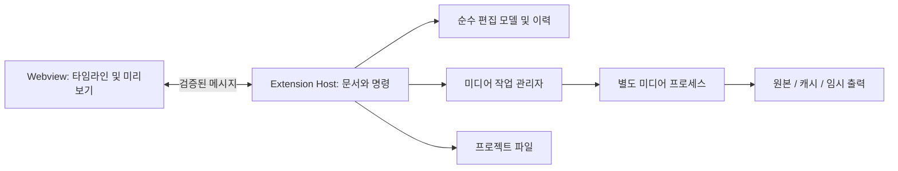

# 비디오 편집기 상세 설계

상태: 단계 2 모델 구현 중인 설계 초안. [요구사항](video-editor-requirements.md)과 [구현 계획](implementation-plan.md)을 함께 읽는다. 수치와 구조는 초기 설계이며 구현·검증 결과에 따라 갱신한다.

## 1. 범위와 전제

MVP는 로컬 데스크톱 VS Code에서 단일 프로젝트, 영상 트랙 하나와 여러 오디오 트랙을 편집한다. 여러 영상 트랙의 합성, 효과, 전환, 속도 변경은 범위 밖이다. 원본은 읽기 전용이고 편집 결과는 프로젝트와 별도 출력 파일에 저장한다. 웹 확장과 원격 확장 호스트 지원은 대상 환경을 결정한 뒤 별도 검증한다.

첫 지원 조합은 WebM/VP9/Opus 입력 및 출력으로 검증한다. PNG 프레임 출력과 WAV 오디오 입력도 각각 이미지 및 무압축 오디오의 후보로 검증한다. 실제 지원은 선정한 빌드와 플랫폼 테스트가 통과한 범위만 표시한다. 사용자가 별도 설치한 FFmpeg + libvpx + libopus를 외부 프로세스로 연결하는 방식을 우선 검증하되 [라이선스 비교](codec-license-comparison.md)의 배포 조건과 성능 검증 전까지 확정하지 않는다.

엔진 검색·설치 안내와 배포 방식은 [미디어 엔진 배포와 연동 설계](media-engine-distribution.md)를 따른다.

## 2. 구성과 책임



- **Extension Host:** VS Code 문서 수명주기, 저장·복구, 파일 선택, 신뢰 경계, 작업 관리 및 오류 보고. Webview는 프로젝트 데이터의 권위 있는 저장소가 아니다.
- **편집 모델:** 시간 변환, 불변 프로젝트 상태, 편집 명령과 이력. VS Code와 코덱에 의존하지 않아 단위 테스트할 수 있다.
- **미디어 어댑터:** probe, 프레임 디코딩, 썸네일·파형, 미리보기 및 출력 인터페이스. FFmpeg 세부 명령은 어댑터 내부에 둔다.
- **Webview:** 상태 스냅샷을 표시하고 사용자 의도를 전달한다. 원본 영상 전체를 메시지에 담지 않는다. CSP, 로컬 리소스 범위와 메시지 스키마를 제한한다.
- **작업 관리자:** 우선순위, 취소, 프로세스 종료, 진행률, 임시 파일 및 캐시를 관리한다. 대량 작업이 UI를 막지 않아야 한다.

권장 구조는 `src/extension`, `src/model`, `src/media`, `src/webview`, `src/shared`, `test/unit`, `test/integration`, `test/e2e`, `test/fixtures`다. 실제 구조와 실행 명령은 구현 후 기록한다.

## 3. 프로젝트와 시간 모델

### 3.1 데이터 계약

프로젝트는 버전이 있는 JSON 문서로 설계한다. 아래는 개념 모델이며 정수와 유리수의 직렬화 방법은 구현 시 스키마로 고정한다.

```ts
type Rational = { num: string; den: string }; // 정수 문자열, den > 0
type Time = Rational; // 초 단위의 정확한 유리수
type Project = {
  version: 1; id: string; revision: number;
  settings: { width: number; height: number; fps: Rational; sampleRate: number; channels: 2 };
  assets: Asset[]; tracks: Track[];
};
type Asset = {
  id: string; uri: string; fingerprint: { size: string; modified: number };
  duration: Time; streams: StreamInfo[]; // 에셋 전체 길이와 스트림 정보
};
type Track = { id: string; kind: 'video' | 'audio'; muted: boolean; gain: number; clips: Clip[] };
type Clip = {
  id: string; assetId: string; streamIndex: number; linkId?: string;
  start: Time; sourceIn: Time; sourceOut: Time; // [in, out), 재생 속도 1
  gain: number; muted: boolean; fadeIn: Time; fadeOut: Time;
};
```

`sourceIn`/`sourceOut`은 모든 스트림에 공통인 에셋 기준 원점으로 정규화한 미디어 시간이고 `start`는 프로젝트 시간이다. `duration = sourceOut - sourceIn`, `end = start + duration`; `start <= t < end`에서 원본 시각은 `sourceIn + (t - start)`다. 구간은 시작 포함·끝 제외다. 모든 시간은 음수가 아니며 클립 길이는 양수다. 동일 트랙의 클립은 겹치지 않는다. 오디오 클립은 서로 다른 오디오 트랙에서 겹쳐 믹싱할 수 있다. 영상이 없는 구간은 검정, 소리가 없는 구간은 무음이다. 에셋 원점은 컨테이너의 유효 시작 시각을 기준으로 정하며 각 스트림의 시작 PTS와 time base로부터 같은 원점까지의 오프셋을 보존한다. 한 스트림이 다른 스트림보다 늦게 시작하거나 일찍 끝나는 영역은 각각 검정 또는 무음으로 채워 원본 A/V 동기화를 유지한다. 컨테이너 시작 시각이 없으면 선택한 스트림들의 유효 시작 시각 중 가장 이른 값을 사용하고, 기준을 판정할 수 없는 파일은 거부한다. 클립의 원본 범위는 해당 에셋 전체의 유효 시간 범위 안에 있어야 한다.

### 3.2 프레임·샘플 규칙

- 프로젝트 FPS가 `p/q`일 때 프레임 `n`의 시작은 `n*q/p`초다. 영상 클립의 타임라인 시작과 편집 경계는 이 격자에 맞춘다. 독립 오디오 클립의 경계는 오디오 샘플 격자에 맞추며 연결된 A/V 편집은 영상 격자를 따른다. 스트림의 시작·끝이 격자와 어긋나는 경우 타임라인에 추가할 때 영상은 시작 이상인 첫 프로젝트 프레임부터 유효 원본 범위를 벗어나지 않는 마지막 경계까지 사용하며, 빈 범위는 거부한다. 표시 시간 코드는 초기에는 프레임 번호와 경과 시간을 사용하며 드롭 프레임 표기는 추후 지원한다.
- CFR 출력 프레임 `n`은 그 시작 시각의 타임라인 상태를 샘플링한다. 원본 VFR은 디코드된 표시 시각(PTS)과 표시 구간을 기준으로 해당 시각을 포함하는 프레임을 선택한다. 시작 전·끝 이후는 검정이다. 원본 프레임 탐색은 PTS 순으로 수행하고, 프로젝트 프레임 이동은 출력 격자를 따른다. 중복·누락 PTS 및 마지막 프레임 지속 시간은 미디어 probe 결과로 판정하고 판정 불가 시 오류를 표시한다.
- 오디오 출력 샘플 `i`는 `i / sampleRate`초에 해당한다. 샘플 및 프레임 변환은 유리수 정수 연산을 사용하고 경계 반올림 규칙은 시작 이상인 첫 샘플(ceil)로 통일한다. 원본 오디오는 타임스탬프 오프셋을 반영해 프로젝트 샘플레이트로 리샘플한다.
- 탐색 시 앞선 키프레임부터 디코딩해 표시 순서와 PTS를 확인한다. 단순 키프레임 탐색 결과를 정확한 프레임으로 취급하지 않는다. VFR의 인덱스 구성 비용과 성능은 1단계에서 검증하며, 정확도를 보장할 수 없는 입력은 명시적으로 거부한다.

### 3.3 저장과 복구

프로젝트 경로 기준 상대 URI를 우선 사용하고 외부 파일은 URI로 기록한다. 재열기 시 크기·수정 시각으로 변경 가능성을 알린다. 이 정보는 동일성의 증명이 아니므로 파일 재연결 시 probe 및 사용자 확인이 필요하다. 유효하지 않은 스키마와 미지원 버전은 원본을 덮어쓰지 않고 오류를 표시한다. 저장은 임시 파일을 같은 디렉터리에 쓰고 가능한 경우 원자적으로 교체한다. 실패 시 기존 파일과 수정 상태를 보존한다. 자동 저장·백업은 VS Code 문서 수명주기와 연동하고 충돌 시 복구 선택을 제공한다. 비로컬 파일 시스템의 원자성은 별도 검증 전 보장하지 않는다.

## 4. 편집 동작

편집은 검증된 명령을 모델에 적용하여 새 revision을 만든다. 실패·변경 없음은 이력을 만들지 않는다. undo/redo는 각 명령의 이전·이후 모델을 복원하고 새 명령은 redo를 지운다. 재생 헤드·확대율은 UI 상태로 관리한다.

- **추가/이동:** 영상과 연결된 A/V는 프로젝트 프레임 격자에, 독립 오디오는 샘플 격자에 맞춘다. 같은 트랙의 충돌은 거부한다. 연결된 A/V는 함께 이동한다.
- **트림:** 한쪽 경계를 이동하고 대응하는 원본 in/out을 조정한다. 원본 범위 밖, 0 길이, 영상 겹침은 거부한다. 연결된 A/V를 함께 조정한다.
- **분할:** 내부 프레임 경계에서 왼쪽과 오른쪽 클립을 만들고 원본 구간을 정확히 나눈다. 연결된 클립도 같은 시점에 나누며 새 연결 그룹을 만든다. 경계 밖 분할은 거부한다.
- **삭제와 리플 삭제:** 일반 삭제는 빈 구간을 남긴다. 리플 삭제는 선택한 클립 또는 명시적으로 선택한 빈 구간을 대상으로 한다. 클립 선택 시 연결 클립도 함께 삭제한다. 선택 구간의 양 끝은 프로젝트 프레임 격자에 맞춘다. 선택 구간 끝 이후의 모든 트랙 클립을 같은 길이만큼 당긴다. 프레임 길이가 오디오 샘플 길이의 정수배가 아닐 수 있으므로 독립 오디오 이동은 원래의 정확한 유리수 시간에서 리플 길이를 빼서 보존하고, 출력 시 샘플 격자로 변환한다. 이로 인해 이동된 독립 오디오 경계는 샘플 격자 밖에 놓일 수 있으며 이후 직접 이동·트림할 때 샘플 격자에 맞춘다. 선택 구간 안에 삭제 대상이 아닌 클립이 있거나 경계를 가로지르는 다른 클립이 있으면 조작을 거부해 우발적 데이터 손실을 막는다.
- **오디오 분리:** 영상과 오디오의 연결을 해제하고 오디오 클립을 독립적으로 편집한다. 음소거·삭제는 타임라인 인스턴스에만 적용한다.
- **스냅:** 화면 픽셀 기준 허용 거리 내에서 재생 헤드·클립 경계를 후보로 선택한 뒤, 영상과 연결된 A/V는 프레임 격자, 독립 오디오는 샘플 격자로 양자화한다. 충돌 시 동작을 거부하고 이유를 표시한다.

## 5. 미디어와 재생

### 5.1 가져오기 및 프레임

여러 파일을 선택하면 각 파일을 독립적으로 검사해 성공한 항목만 추가하고 실패 항목을 개별 표시한다. 파일 선택 후 probe로 스트림 인덱스, time base, 시작 PTS, 길이와 코덱을 확인한다. 성공 전에는 기존 프로젝트 상태를 바꾸지 않는다. 썸네일과 파형은 원본 식별 정보, 스트림, 생성 버전과 해상도 기준으로 캐시한다. 용량 상한과 LRU 정리, 원본 변경·생성 버전 변경 시 무효화를 적용한다. 프레임 추출은 선택된 Source 또는 Timeline의 현재 표시 프레임을 PNG로 저장한다. Timeline 추출은 편집 결과를 따르며 빈 영상 구간은 검정 프레임이다. 유효한 현재 프레임이 없거나 디코딩이 완료되지 않았다면 추출을 제한한다. 입력 파일과 프로젝트 파일 덮어쓰기를 방지한다.

### 5.2 화면 모드와 미리보기

하나의 편집기 탭 안에서 `Preview`와 `Edit` 모드를 전환한다. 이는 초기 UI 설계이며 원본·타임라인 대상 선택과는 별개의 상태다.

| 항목 | Preview | Edit |
| --- | --- | --- |
| 화면 | 큰 영상 화면과 재생·탐색 컨트롤 | 영상 화면, 미디어 목록, 타임라인 및 편집 컨트롤 |
| 재생·프레임 탐색 | 가능 | 가능 |
| 클립·오디오 편집 | 숨기고 명령도 거부 | 가능 |
| 미리보기 대상 | 원본 또는 타임라인 선택 | 원본 또는 타임라인 선택 |

모드 선택은 편집기 인스턴스별 보기 상태이며 Host가 승인된 모드의 기준을 유지한다. 이 상태는 프로젝트 데이터나 undo/redo 이력을 바꾸지 않는다. 전환 버튼은 현재 모드를 접근성 상태로 표시하고 키보드로 조작할 수 있다. 프로젝트 내 선택, 타임라인 확대·스크롤, 각 대상의 재생 위치를 유지한다. 전환 시 재생을 일시정지하고 현재 위치를 보존하며, 이전 모드의 비동기 디코딩 응답은 폐기한다. 다시 재생하는 것은 사용자의 명시적 조작이다. 원본과 타임라인은 시간 좌표가 다르므로 대상 전환 시 재생을 일시정지하고 각자의 마지막 위치를 복원하며 이전 대상의 늦은 응답을 폐기한다. 미디어가 없으면 빈 상태와 가져오기 안내를 표시한다.

편집 명령은 UI에서 숨기는 것뿐 아니라 확장 호스트에서도 현재 모드와 메시지를 검사해 Preview 상태에서 거부한다. 저장, 모드 전환, 탐색 등 비편집 명령은 허용한다. 모드 전환 또는 대상 전환이 작업 중 발생해도 프로젝트 revision, 수정 상태와 이력은 변하지 않는다.


원본 및 타임라인 미리보기는 같은 시간·믹싱 규칙을 사용한다. 재생 시 오디오 장치 시계를 기준으로 화면 프레임을 표시하고 늦은 프레임은 건너뛸 수 있으나 타임라인 시간을 바꾸지 않는다. 일시정지·탐색 시 정확한 프레임을 표시한다. 탐색 요청마다 증가하는 ID와 revision을 부여하고 이전 작업을 취소하며, 늦은 응답은 ID와 revision을 비교해 폐기한다. 미리보기 축소 해상도는 시간이나 편집 결과를 바꾸지 않는다. 오디오가 없는 프로젝트는 단조 증가 시스템 시계를 기준으로 재생한다. 오디오 장치가 없으면 상태를 알리고 무음 재생을 선택할 수 있게 한다. 디코딩 지연도 표시한다.

### 5.3 오디오 믹싱

활성 클립을 프로젝트 샘플레이트와 스테레오로 변환한 뒤 `sum(sample * clipGain * trackGain * fade)`로 합산한다. 기본 gain은 1, 음소거 gain은 0이다. 페이드는 클립 경계에서 선형이며 길이는 클립 길이를 넘지 않는다. 채널 변환 규칙과 범위는 구현 단계에서 고정·문서화한다. 최종 출력은 [-1, 1]로 제한하고 클리핑 발생을 알린다. 이는 경고이며 실시간 피크 미터는 다음 단계다. 미리보기와 출력은 같은 게인·페이드·채널 변환 규칙을 사용한다.

## 6. 출력과 작업 안전성

출력 요청은 프로젝트 revision의 불변 스냅샷과 명시적인 해상도·품질·오디오 설정을 사용한다. MVP의 출력 FPS는 프로젝트 FPS와 같으며, FPS 변경은 프로젝트 설정 변경으로 취급하고 기존 편집 경계 재양자화 정책이 확정되기 전에는 제공하지 않는다. 렌더러는 위 시간 규칙으로 영상과 오디오를 만들고 WebM/VP9/Opus로 인코딩하는 방식을 우선 검증한다. 코덱 지연·패딩과 시작 PTS를 처리하고 결과를 재디코딩해 길이와 동기화를 확인한다. 진행률은 처리된 타임라인 시간 기준이며 취소·실패 시 하위 프로세스를 종료하고 임시 출력을 정리한다. 성공한 출력만 선택 경로에 이동한다. 기존 파일 덮어쓰기는 명시적 사용자 선택이 필요하다. 원본·프로젝트와 같은 경로는 거부한다.

프로세스 실행은 셸을 거치지 않고 인자 배열을 사용한다. Webview가 임의 실행 파일이나 경로를 직접 지정하지 못하도록 Host가 권한과 경로를 검증한다. 실패 코드는 `UNSUPPORTED`, `DECODE`, `MISSING_MEDIA`, `INVALID_PROJECT`, `EXPORT`, `CANCELLED` 등으로 구분하고 사용자에게 복구 방법을 안내한다.

## 7. 검증 설계

- **단위:** 유리수 시간 변환과 경계, VFR PTS 선택, 편집 명령·이력, 스냅, 게인·페이드·믹싱 및 클리핑.
- **통합:** 실제 선정 엔진으로 probe, 키프레임 사이 탐색, 프레임 추출, 오디오 처리, 출력·재디코딩, 취소와 오류 정리. 프레임별 식별 가능한 합성 영상과 주파수·레벨이 알려진 음원을 사용한다.
- **E2E:** 격리된 VS Code Extension Development Host에서 가져오기부터 편집, 저장·재열기, 출력까지 UI와 실제 엔진을 연결한다. 결과의 영상 경계와 오디오 신호를 독립적으로 검사한다. 손실 인코딩에는 사전에 정한 정량 허용 오차를 적용한다.
- **실패·회귀:** 없는 원본, 손상 파일, 지원하지 않는 코덱, 프로젝트 버전, 저장 오류, 빠른 연속 탐색, 작업 취소, 충돌과 복구. 원본 해시가 변하지 않음을 확인한다.
- 플랫폼별 재생 장치, 시각적 품질 및 성능 목표는 자동 테스트와 별도로 실측하고 환경과 결과를 기록한다.

## 8. 미결정 사항

미디어 엔진의 프레임 전달·실시간 오디오 구현 방식과 목표 지연, 대상 OS·아키텍처, 프레임·해상도 제한 및 성능 목표, 패키지 크기와 코덱 빌드·배포 방식, 프로젝트 자체 라이선스, 자동 저장 정책, 오디오 채널 변환 계수, VFR/불완전 PTS 처리 세부 조건은 구현 중 검증 후 확정한다. 확정 전에는 지원 또는 배포 준비가 완료되었다고 표시하지 않는다.

## 9. 단계 2 구현 현황

`src/model/`에 유리수 시간, 단일 영상·다중 오디오 트랙의 검증과 편집·이력, 로컬 프로젝트 저장·읽기 및 원본 검사·재연결 함수가 있다. 명령 팔레트에서 새 프로젝트 생성과 저장·열기를 제공한다. 새 프로젝트의 1920×1080, 30fps, 48kHz는 임시 기본값이며 설정 UI는 없다. 원본 누락·변경 상태를 Project media에 표시하고, 사용자가 파일을 선택·확인하면 외부 ffprobe의 스트림과 길이를 검증해 재연결한다. 저장 전 재연결 변경은 미저장 상태로 표시한다. 편집 UI·실제 미디어 가져오기, 자동 저장·백업, OS 파일 대화상자의 실제 조작은 아직 검증하지 않았다. Extension Host E2E는 대화상자의 선택 결과를 테스트에서 주입해 프로젝트 명령과 재연결 UI를 검증한다. 저장 시 같은 디렉터리의 임시 파일을 rename하며 비로컬 및 플랫폼별 원자성은 검증되지 않았다.

## 10. 단계 3 구현 현황

Edit 모드에서 파일을 독립적으로 probe해 VP9 영상·Opus 또는 PCM 오디오를 프로젝트에 추가한다. 각 원본 영상의 ffprobe 표시 PTS 목록을 만들고, Source에서 이전·다음, 1부터 시작하는 프레임 번호, 첫 표시 PTS 기준 경과 초로 탐색하며 표시 중인 프레임을 PNG로 저장한다. 현재 FFmpeg가 파일 처음부터 해당 인덱스까지 디코딩하므로 긴 영상 탐색이 느릴 수 있다. 프레임 인덱스는 16 MiB·20만 프레임으로 제한되며 음수·누락·중복 또는 비단조 PTS는 오류 처리한다. 임시 프레임은 작업마다 삭제하고 최근 요청만 표시한다.

Source 프레임은 구현되었으나 타임라인 미리보기, 오디오 재생, 썸네일·파형 생성과 캐시, 장시간 파일 성능 최적화 및 디코딩 진행률 UI는 아직 미구현이다. 시간 탐색은 마지막 프레임 시작 시각을 초과하면 거부한다. OS 파일 대화상자 직접 조작은 별도 검증이 필요하다.
